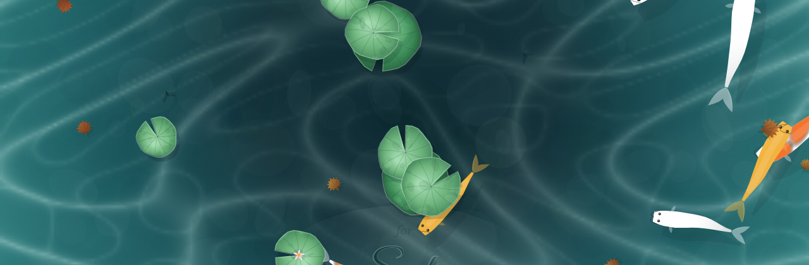
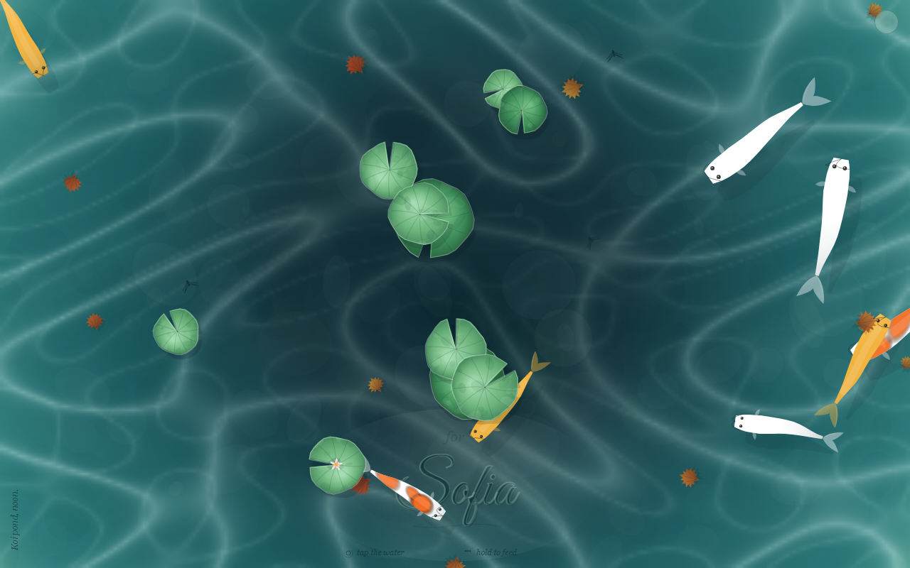

<meta property="og:title" content="Koi pond, noon.">
<meta property="og:description" content="Estanque de koi ambiental en Canvas 2D: peces procedurales, caústicas, nenufares y una dedicatoria pintada en el fondo.">
<meta property="og:image" content="https://raw.githubusercontent.com/Hugopvigo/koi/main/docs/capturas/og.png">

<p align="center">
  
</p>

<p align="center">
  
</p>

<p align="center">
  <b>Un estanque de koi donde no hay nada que hacer.</b><br>
  Solo mirar. Peces que nacen de una onda, luz que se mueve en el fondo y una tarde quieta de mediodía.
</p>

<p align="center">
  <a href="https://hugopvigo.github.io/koi/"></a>
  
  
  
  
</p>

---

## Qué es esto

**Koi pond, noon.** es una ilustración interactiva en Canvas 2D: una vista cenital de un estanque de jardín a mediodía. No tiene objetivo, pantalla de inicio ni puntuación; es un sitio donde descansar la vista. Todo el HTML, el CSS y el JavaScript van en un único `index.html`, sin dependencias ni paso de compilación.

El fondo del estanque está dedicado a **Sofia**: su nombre aparece pintado con trazo de pincel sobre el lecho, con la luz y las sombras de los peces pasando por encima.

## Características

- **Peces procedurales vivos.** Cada koi es una cadena de segmentos de columna movida por una onda viajera, con perfil de anchura, aletas pectorales que reman, cola en abanico y un patrón de manchas generado con ruido sembrado y recortado a la forma del cuerpo. Las variedades son kohaku, showa, ogon, tancho y blanco.
- **Movimiento hacia delante.** La cabeza marca la posición del pez y el cuerpo se encadena hacia atrás, así que la cola siempre va detrás. La dirección solo cambia girando, con una tasa de giro limitada: ningún pez se da la vuelta de golpe ni nada marcha atrás.
- **Comportamiento.** Deambulación con rumbo que deriva sin quedarse clavado en los ejes, separación suave, evitación de bordes y nenufares, arranques de cola y planeo, sobresalto ante las ondas, curiosidad hacia el puntero que se mueve despacio y convergencia en remolino cuando cae comida.
- **Agua con profundidad.** Fondo con moteado y caústicas generadas en un canvas de baja resolución y escaladas, sombras desplazadas y difusas de los peces, nenufares agrupados con textura y flores rosadas pequeñas, efímeras rojas que giran, caballitos del diablo que pasan con su sombra y libélulas que cruzan de vez en cuando.
- **Interacción.** Clic o toque → ondas concéntricas que asustan a los peces cercanos. Mantener pulsado o doble toque → puñado de pellets: todos los koi giran, se apiñan, abren la boca y dejan anillos al comer, para dispersarse después. El puntero se sustituye por un anillo que se rellena mientras mantienes. Con el estanque enfocado, `Enter` hace una onda y `Espacio` echa comida.
- **Sonido opcional.** Desactivado por defecto: un hilo de agua y plops sintetizados con ruido filtrado y Web Audio.
- **Tipografía casi invisible.** Un letrero vertical «Koi pond, noon.», una pista que se desvanece al usar cada gesto y el nombre del pez más cercano al cursor, todo en itálica Georgia.
- **Respeto por la máquina.** Máximo 14 peces (menos en pantallas pequeñas), DPR limitado a 2, caústicas a baja resolución y soporte de `prefers-reduced-motion` (peces a un tercio de velocidad, sin animación de caústicas y ondas suaves).

## Uso

Abre `index.html` en cualquier navegador moderno. No necesita servidor ni instalación.

Si prefieres servirlo localmente:

```bash
python -m http.server 8000
```

y visita `http://localhost:8000/`.

## Publicar en GitHub Pages

El proyecto es estático y compatible con GitHub Pages sin compilación:

1. En el repo, entra en **Settings → Pages**.
2. En **Build and deployment**, elige **Deploy from a branch**.
3. Selecciona la rama `main` y la carpeta **/ (root)**, y guarda.
4. Espera unos segundos a que termine el despliegue.

La URL es `https://hugopvigo.github.io/koi/`. El fichero `.nojekyll` evita que Pages procese el HTML con Jekyll.

## Estructura

```
.
├── index.html                 # aplicación completa (HTML + CSS + JS)
├── docs/capturas/
│   ├── 00-cabecera.png        # cabecera del README
│   ├── 01-desktop.png         # captura real del estanque
│   ├── og.png                 # imagen social (1200×630)
│   └── preview.webp           # vista previa 1280×800
├── LICENSE                    # CC BY-NC-SA 4.0
├── PRODUCT.md                 # contexto y decisiones del producto
└── README.md                  # este archivo
```

## Licencia

[Creative Commons Attribution-NonCommercial-ShareAlike 4.0 International](https://creativecommons.org/licenses/by-nc-sa/4.0/). Puedes compartir y adaptar el proyecto con fines no comerciales, citando a Hugo Perez-Vigo y manteniendo la misma licencia en las obras derivadas.

---

<p align="center">
  Desarrollado por <a href="https://github.com/Hugopvigo">Hugo Perez-Vigo</a> · <a href="https://hugoperezvigo.es">hugoperezvigo.es</a>
</p>
